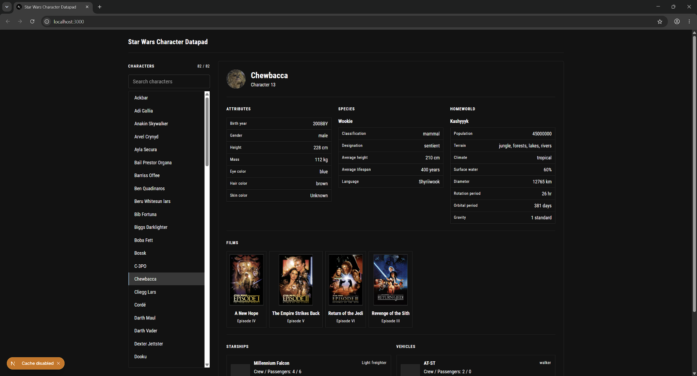

# sw-take-home

<p align="center">
  
</p>

This is a [Next.js](https://nextjs.org/) project bootstrapped with `create-next-app`, configured to use [Yarn](https://yarnpkg.com/getting-started/install) for package management.

## Getting Started

First, install the project dependencies:

```bash
yarn install
```

Next, run the development server:

```bash
yarn dev
```

Open [http://localhost:3000](http://localhost:3000) with your browser to see the result.

You can start editing the page by modifying `app/page.tsx` (or `app/page.js`). The page auto-updates as you edit the file.

This project uses [`next/font`](https://nextjs.org) to automatically optimize and load the font family.

> [!TIP]
> If you are using Visual Studio Code, you can use the [debugging configuration](https://code.visualstudio.com/docs/debugtest/debugging-configuration) defined in `.vscode/launch.json`. Each configuration appears in the configuration dropdown in the Run and Debug view. Try using the **Next.js: debug full stack** to start debugging both the server and client.

## Testing

> [!NOTE]
> Currently, there are **no unit tests** so running them is not an issue.

The reason for this is because I believe that unit tests should only be written when necessary to test business logic, or if you are told to do so and it's not your decision. Most of the time I see unit tests, they are just testing language features, more work than would ever be necessary, and their only real contibution is to increasing the build time.

If there were to be some complex business logic added to this project, or rather any business logic, then I would write a test to verify that logic not only is working correctly now but even more importantly that it does not break later on.

## Acknowledgements

- [vieraboschkova/swapi-gallery](https://github.com/vieraboschkova/swapi-gallery)

## Learn More

To learn more about Next.js, take a look at the following resources:

- [Next.js Documentation](https://nextjs.org/docs) - learn about Next.js features and API.
- [Learn Next.js](https://nextjs.org/learn) - an interactive Next.js tutorial.

You can check out [the Next.js GitHub repository](https://github.com/vercel/next.js) - your feedback and contributions are welcome!
